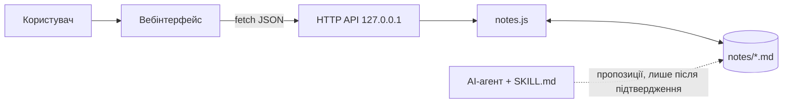

# Архітектура Second Brain

## Компоненти
| Компонент | Файл | Відповідальність |
|---|---|---|
| Сховище | `notes/<Категорія>/*.md` | Markdown + YAML frontmatter, єдине джерело істини |
| Ядро | `src/notes.js` | парсинг, пошук, фільтр, зв’язки, створення/оновлення |
| API | `src/server.js` | JSON API, статика, валідація, обробка помилок |
| Інтерфейс | `src/public/*` | список, категорії, теги, перегляд, форма, редагування |
| Навичка агента | `.agents/skills/second-brain/SKILL.md` | правила класифікації та безпеки |
| Перевірка | `tests/*.test.js` | юніт-, API- та репозиторні тести |

## Потоки даних

1. **Читання**: `GET /api/notes?q=&tag=&category=` → `loadNotes` читає всі `.md` → `filterNotes` → короткі описи + статистика категорій/тегів.
2. **Відкриття**: `GET /api/notes/<Категорія>/<файл>` → тіло, розв’язані `[[посилання]]`, зворотні посилання.
3. **Запис**: `POST/PUT` → валідація → запис у файл (`wx` для нових — без перезапису; тимчасовий файл + `rename` для оновлень).

## Модель нотатки
| Поле | Значення |
|---|---|
| `title` | унікальна назва (використовується у `[[...]]`) |
| `created`, `updated` | `YYYY-MM-DD` |
| `type` | `inbox`, `project`, `area`, `resource`, `archive`, `moc` |
| `status` | `draft`, `active`, `archived` |
| `tags` | список у нижньому регістрі |
| `source` | походження; лише те, що вказав автор |

## Ключові рішення
- **Markdown + файли**: читається без застосунку, добре працює з Git, немає vendor lock-in.
- **Node.js без залежностей**: відтворюваність (`npm start`), немає ланцюга постачання.
- **Прив’язка до 127.0.0.1**: інтерфейс недоступний із мережі.
- **Зв’язки за `title`**: просто для людини; ціна — перейменування ламає посилання (їх видно як «зламані»).

## Критерії приймання
1. Нову нотатку можна створити й вона з’являється у списку та у файлі.
2. Пошук за словом знаходить нотатку; відсутній збіг дає зрозуміле повідомлення.
3. Фільтр за тегом і категорією працює окремо та разом.
4. `[[посилання]]` відкриває цільову нотатку; зламане — помітне.
5. Дані зберігаються після перезапуску сервера.
6. `npm test` проходить; немає секретів у репозиторії.

## Ризики
| Ризик | Мітигація |
|---|---|
| Витік приватних даних | локальна робота, `.gitignore`, заборона чутливих даних у нотатках |
| Втрата даних | окрема резервна копія `notes/`; атомарний запис; `wx` проти перезапису |
| Агент пошкодив/вигадав дані | перегляд diff, правила `SKILL.md`, `tests/repo-notes.test.js` |
| Path traversal | id шукається у списку, а не будується зі шляху; статика перевіряє каталог |
