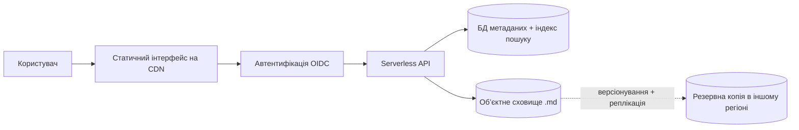

# Хмарне розширення (проєктне рішення, без розгортання)

## Архітектура

## Компоненти
- **Статичний інтерфейс**: той самий `src/public`, розміщений на CDN.
- **Автентифікація**: OIDC/OAuth, MFA; доступ лише власнику.
- **Об’єктне сховище**: Markdown-файли з версіюванням (захист від випадкового видалення).
- **БД/пошуковий індекс**: метадані, теги, зв’язки, повнотекстовий пошук.
- **API**: ті самі маршрути, що й локально, але з перевіркою токена.
- **Резервування**: версіонування, регулярні знімки, копія в іншому регіоні/у іншого провайдера, періодична перевірка відновлення.
- **Шифрування**: TLS у каналі, шифрування сховища (бажано ключем користувача).

## Порівняння
| Критерій | Локальна версія | Хмарна версія |
|---|---|---|
| Приватність | висока: дані не залишають пристрій | нижча: дані в провайдера, потрібні шифрування та контроль доступу |
| Доступність | лише на одному пристрої | з будь-якого пристрою, є ризик збою провайдера |
| Вартість | практично нульова | постійна оплата сховища, трафіку, обчислень |
| Vendor lock-in | немає (файли `.md`) | є: специфічні БД, auth, serverless; зменшується відкритими форматами й експортом |
| Складність експлуатації | мінімальна | висока: безпека, моніторинг, резервування, оновлення |
| Резервування | вручну | вбудоване, але його треба налаштувати й перевіряти |

## Як зменшити vendor lock-in
Зберігати первинні дані у `.md`; інтерфейс до сховища ізолювати за адаптером; використовувати стандартні протоколи (S3-сумісний API, OIDC); мати регулярний повний експорт.
